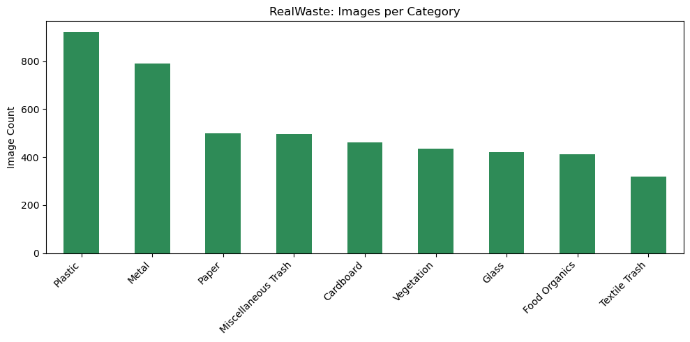
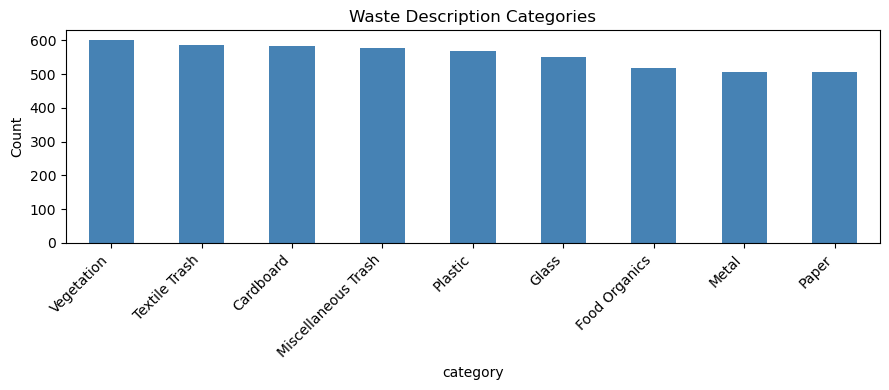
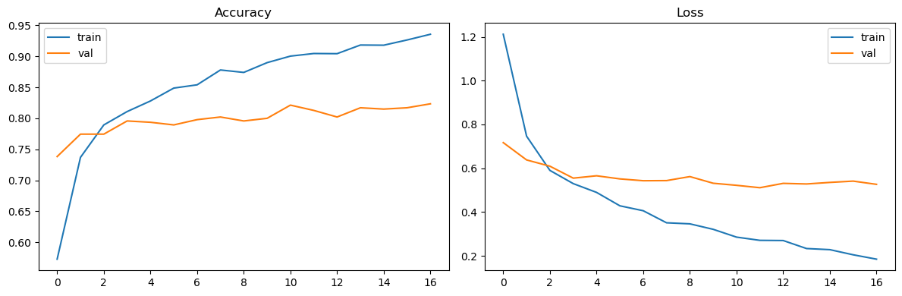
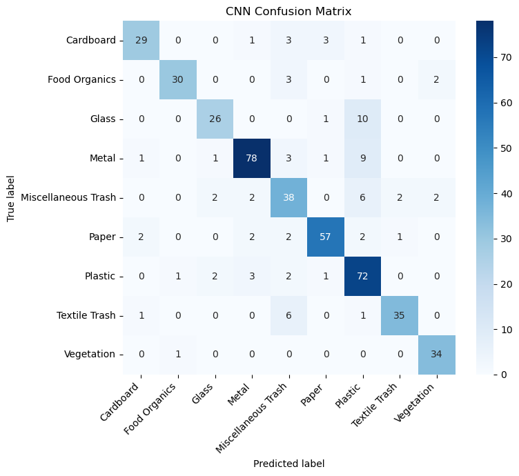
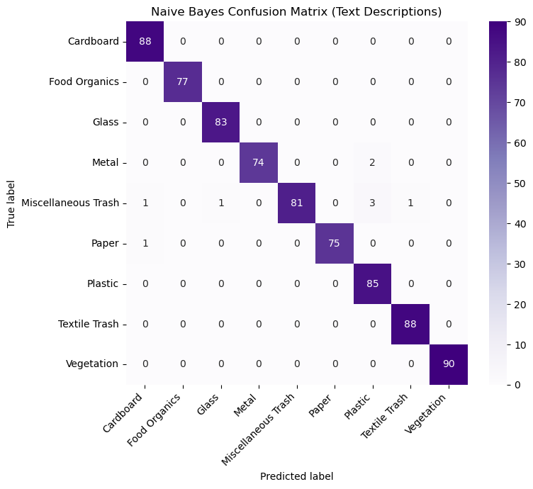

# EcoSort Waste Management Assistant

Can one system look at a photo of rubbish, read a short description of it, and then tell a resident how to dispose of it properly? This project builds that assistant end to end: a CNN for images, a text classifier for descriptions, and a retrieval-augmented generator for recycling instructions, all joined into a single pipeline.

**Short answer:** the classifiers work well and the generator does not. The image model reaches **83.1%** test accuracy on nine waste categories, the text model reaches **98.8%**, and retrieval reliably finds the right policy text. The weak link is the small generative model, which often returns list fragments instead of clean sentences. The project reports that plainly.

## Problem Statement

EcoSort is a (fictional) company working with Metro City's waste management department. Residents often put items in the wrong bin, which costs facilities time sorting material by hand. The assistant has to:

1. Identify waste from an uploaded image (CNN).
2. Classify waste from a text description (classical ML, with a transformer as the documented alternative).
3. Generate disposal instructions grounded in city policy (RAG with a generative transformer).

## Datasets

| Dataset | Size | Role |
|---|---|---|
| **RealWaste** (images) | 4,752 images, 9 categories, all 524x524 | Train and test the CNN |
| **waste_descriptions.csv** | 5,000 short descriptions, 9 categories | Train and test the text classifier, build retrieval snippets |
| **waste_policy_documents.json** | 14 policy documents | Retrieval corpus for RAG |

The nine categories are shared by all three components: Cardboard, Food Organics, Glass, Metal, Miscellaneous Trash, Paper, Plastic, Textile Trash and Vegetation.

Things the exploration found that shaped later choices:

- **The image data is imbalanced.** Plastic has 921 images, Textile Trash only 318. Accuracy alone would hide weak classes, so per-class metrics and class weights are used.
- **The descriptions are tiny and templated.** The mean length is 4.85 words and the vocabulary is only 305 unique words. This is why a bag-of-words model was chosen over a transformer.
- **Policy coverage is uneven.** Paper has a single dedicated policy document, while Metal, Miscellaneous Trash and Vegetation have four each. Thin coverage later shows up as weaker generated text.





## Approach

1. **Data pipelines.** `image_dataset_from_directory` with a seeded 80/20 split, then the validation half is split again into validation and test sets. Text is cleaned, label-encoded and split 70/15/15 with stratification. TF-IDF is fit on the training split only to avoid leakage.
2. **Image classifier.** MobileNetV2 (ImageNet weights) as a frozen backbone with a small dense head. Training uses light augmentation (flip, rotation, zoom, contrast), early stopping, checkpointing and a learning rate schedule.
3. **Fine-tuning.** The top of the backbone is unfrozen at a learning rate of 1e-5 with balanced class weights. The result is compared against the frozen-head model explicitly, and the better one is kept.
4. **Text classifier.** Naive Bayes, Random Forest and XGBoost are compared on validation accuracy using TF-IDF unigram and bigram features.
5. **Retrieval corpus.** 59 chunks: the 14 policy documents plus 45 disposal-instruction snippets from the CSV. TF-IDF cosine similarity with a category boost retrieves the top chunks. A `sentence-transformers` dense retriever is built alongside it for comparison.
6. **Generation.** `google/flan-t5-small` with a retrieval-augmented prompt, lightly fine-tuned on 45 prompt and instruction pairs (5 per category, 3 epochs). Beam search with repetition controls is the default.
7. **Integration.** A single `waste_management_assistant()` function takes an image path or a text description, predicts the category, retrieves policy, generates instructions, and returns a structured result. It includes error handling and a feedback log.

## Key Results

### Image classification: good, with one hard category

| Metric | Value |
|---|---|
| Test accuracy (frozen-head MobileNetV2) | **83.13%** |
| Test accuracy after fine-tuning | 83.13% |
| Best epoch (by validation loss) | Epoch 12 of 17 |
| Trainable parameters | 165,129 of 2,423,113 |

- **Vegetation (F1 0.93) and Food Organics (F1 0.88) are the strongest classes.**
- **Miscellaneous Trash is the weakest** (precision 0.67, F1 0.70). It is defined by what it is not, so it has no consistent look.
- **The most common confusion is Glass predicted as Plastic (27.0% of Glass images)**, followed by Textile Trash to Miscellaneous Trash (14.0%) and Miscellaneous Trash to Plastic (11.5%). Clear glass bottles and clear plastic bottles do look alike.
- **Training accuracy reached 93.6% while validation sat near 81%**, a sign of some overfitting on the head.
- **Fine-tuning did not help.** It tied the baseline at 83.13%, so the explicit comparison in the code kept the simpler frozen-head model.





### Text classification: near ceiling

| Model | Validation accuracy |
|---|---|
| Naive Bayes | **99.20%** |
| XGBoost | 98.67% |
| Random Forest | 98.40% |

Naive Bayes won and scored **98.80% on the held-out test set**, with only 9 of 750 descriptions misclassified. Every category has precision and recall of at least 0.93. The weakest spot is again Miscellaneous Trash (recall 0.93), the same catch-all category that troubled the CNN. The simplest model winning makes sense here: sparse keyword features suit its independence assumption, and the larger models have more capacity than this templated data needs.



### Retrieval and generation: retrieval works, generation is fragile

- **Retrieval is reliable.** For "How to recycle Plastic" the top chunks are all Plastic-related, and for Glass the three retrieved sources are all genuinely about Glass.
- **TF-IDF and dense retrieval did not separate on this tiny corpus.** Both returned the same top chunk for a literal query and for a paraphrased one, so the lightweight TF-IDF retriever stays as the default.
- **Plastic, Metal and Food Organics produce short, grounded sentences.** Glass returns a list-style fragment copied almost verbatim from its policy document, and Textile Trash returns a truncated fragment.
- **Sampling hurts grounding.** At temperature 0.7 and 1.2 the model produced fluent but invented text that appears nowhere in the policy documents, so beam search is the default.
- **Factual overlap with retrieved context:** Plastic 1.00, Metal 1.00, Glass 0.69.

### Integrated assistant

- Text and image inputs both flow through the same pipeline into the same RAG step, because they share one label space.
- A sample Cardboard image was classified correctly (confidence 0.56).
- Edge cases behave sensibly: "greasy pizza box" goes to Cardboard, "broken drinking glass" to Glass.
- **"Used batteries" lands in Miscellaneous Trash with only 15.2% confidence.** Batteries are hazardous waste, which is not one of the nine categories, so the low confidence is the right signal. The example is logged through the feedback mechanism as a candidate for future retraining.
- Three bad inputs (missing image path, empty text, unsupported input type) each return a clean `{'error': ...}` dictionary instead of crashing.

## Conclusions

- Transfer learning with a frozen MobileNetV2 is enough for a solid image baseline on a small, imbalanced dataset, and extra fine-tuning is not automatically better.
- For short, templated text, TF-IDF with Naive Bayes beat heavier models and needs no GPU.
- Miscellaneous Trash is hard in both modalities because it is a catch-all rather than a visually or lexically distinct class.
- A small generative model needs strong grounding and conservative decoding. Without them it drifts into fluent but wrong text, which is unacceptable for a system that states real disposal policy.

## Limitations and Next Steps

- **The image split is random, not stratified,** so per-class proportions can drift between train, validation and test.
- **The generator is the weakest part.** Options include a larger instruction-tuned model, templated answers built directly from retrieved text, or a post-generation check that rejects low-overlap output.
- **The retrieval corpus is only 59 chunks.** More and better structured policy documents, especially for Paper, would help both retrieval and generation.
- **Hazardous items have no category.** Adding a Hazardous Waste class and an "unsure" threshold would handle cases like batteries safely.
- **The text data is synthetic.** The 98.8% accuracy reflects templated phrasing and will likely drop on real resident descriptions.
- **A DistilBERT fine-tune** is the documented alternative for text classification if GPU access is available.
- **The feedback log is in memory only.** A production version would store it in a database and feed it into retraining.

## Tech Stack

Python, TensorFlow and Keras (MobileNetV2), scikit-learn, XGBoost, Hugging Face Transformers and Datasets (flan-t5-small), sentence-transformers, pandas, NumPy, matplotlib, seaborn, Pillow, Jupyter

## How to Run

```bash
git clone https://github.com/ElvisOmondi7/Waste-management-summative-lab.git
cd Waste-management-summative-lab
pip install -r requirements.txt
jupyter notebook waste_management_summative.ipynb
```

The notebook expects these next to it:

- a `RealWaste/` folder containing the 9 category subfolders of images
- `waste_descriptions.csv`
- `waste_policy_documents.json`

The pretrained MobileNetV2, flan-t5-small and MiniLM weights download on first run, so an internet connection is needed once. The RealWaste images are not included in this repo because of their size.

## Repository Contents

```
.
├── waste_management_summative.ipynb   # Full analysis notebook
├── waste_descriptions.csv             # Text dataset (5,000 rows)
├── waste_policy_documents.json        # Policy documents for RAG (14 docs)
├── images/                            # Charts used in this README
├── requirements.txt                   # Python dependencies
└── README.md
```

## Reference

Single, S., Iranmanesh, S. and Raad, R. RealWaste: A Novel Real-Life Data Set for Landfill Waste Classification Using Deep Learning. *Information*, 2023.

## Author

**Elvis Omondi Okoth**, Data Science and Statistics, Nairobi, Kenya

[LinkedIn](https://www.linkedin.com/in/elvis-omondi-200a06264) | okothelvisomondi@gmail.com | [GitHub](https://github.com/ElvisOmondi7)

Completed as a summative lab in the Data Science program at Moringa School.
